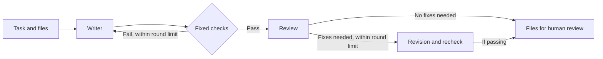

# Ringo

**Your coding agents, together in one terminal.**

[](https://github.com/SkylerLK510/Ringo/actions/workflows/tests.yml)
[](LICENSE)

Ringo brings Claude Code, Codex and other coding agents into a shared terminal workspace.
Hand a conversation from one agent to another, follow their edits and token usage as they
work, and run repeatable jobs through pipelines with executable checks.

The question behind the project is simple: **can a better workflow make the same models
more useful, with less wasted work?** Ringo explores that through code, experiments and
an improvement loop whose results still need evidence and human review.

**Actively developed.** The shell and pipelines are usable today. Recursive self-improvement
is experimental; a measured live improvement has yet to be demonstrated.

[Get started](#quick-start) · [User guide](docs/USER-GUIDE.md) · [Documentation](docs/README.md) ·
[Experiments](#experiments) · [Roadmap](ROADMAP.md) · [Contribute](CONTRIBUTING.md)

## Why Ringo?

A second agent can be useful. Carrying its context back and forth is work. Ringo keeps the
conversation, the jobs and the changes in one place, so another agent can pick up where
the last one left off.

| When you want to… | Ringo gives you… |
| --- | --- |
| Switch perspective | `@claude` and `@codex` in one conversation, with a record of what each did |
| Follow the work | Streaming replies, visible tool steps and edits, live usage and running jobs |
| Stay in control | Permission modes, turn-level undo, and session resume/restart |
| Make a job repeatable | Review, design, work and research pipelines you can invoke from a script |
| Test a workflow idea | Frozen inputs, usage accounting, protected evaluation and explicit adoption gates |

The shell uses your installed agent CLIs and subscription sign-ins. Pipelines also support
local models through Ollama. Ringo orchestrates models; it does not train their weights.

## Quick start

For the terminal shell, install git, a current stable [Rust toolchain](https://www.rust-lang.org/tools/install),
Python 3.11+, and at least one supported agent CLI such as
[Codex](https://github.com/openai/codex) or [Claude Code](https://code.claude.com/docs/en/setup).

```sh
git clone https://github.com/SkylerLK510/Ringo.git
cd Ringo
cargo install --locked --path cli
```

Then open a terminal in a project you want to work on and type `ringo`.
First-run setup helps you select agents and sign in.
Keep the Ringo checkout: the installed binary uses its prompts, plans and Python runtime.

A few things to try in the shell:

```text
@codex explain how this project is organized
@claude check that explanation against the code
/usage
```

Each task you send uses the selected agent's allowance. The default `ask` mode lets agents
read and edit project files; other actions depend on the agent's permission support.
See the [user guide](docs/USER-GUIDE.md#choose-how-much-agents-may-do) for the exact behavior.

The [setup guide](docs/GETTING-STARTED.md) covers macOS, Linux, Windows/WSL, agent sign-in,
PATH issues and a first pipeline task. Prefer scripts? The Python runtime uses only the
standard library and works without installing Rust.

## From a conversation to a checked result

The shell is for ongoing work. The pipeline CLI is for jobs with a defined input and
an inspectable output:

| Pipeline | Input | Result |
| --- | --- | --- |
| `review` | A git change or review material | Findings you can assess against the code |
| `design` | A brief and constraints | A design proposal |
| `work` | Declared files, a brief and executable checks | Checked files and a review, in a separate run folder |
| `research` | A research brief | A report based on sources Ringo fetches and verifies |

For example, `work` follows this path; failed checks feed the next writer round:



Try the included small coding task from the checkout:

```sh
python3 ringo.py work --spec examples/v3-codex.json --out ~/ringo-runs/first-run
```

This uses Codex to implement `slugify`, runs the example's checks, and reviews the result.
Use a new output directory for each run. Inspect `report.json` and `final/` in that folder;
the [first-run guide](docs/GETTING-STARTED.md#first-run) explains the outputs.
Private run folders belong outside the checkout.

The [pipeline reference](docs/CLI.md) covers commands, backends, model-call counts, time
limits and accounting. The [Design Council](https://github.com/SkylerLK510/DukChulBOT)
is an optional separate scoring component for `work` tasks.

## Experiments

The interesting part is finding out which ideas survive testing. Some have helped;
others have made results worse and were removed.

| Experiment | Observation | What we learned |
| --- | --- | --- |
| [HumanEval+, 154 paired tasks](docs/EXPERIMENTS.md#7-humaneval-the-review-earns-its-place-on-code-2026-10-28) | Ringo passed 147; the standalone Codex agent passed 148. Average tokens per task: 3,500 vs 50,325 | A quality tie with fewer tokens on this study; broader tasks still need testing |
| [Four refinements tested on MBPP+](docs/EXPERIMENTS.md#8-mbpp-four-refinements-from-humaneval-failures-rejected-2026-10-29) | 126 of 150 passed, versus 132 for the prior configuration | Ideas built from one benchmark's failures can hurt on another. All four were removed |
| [Multiple Council judges](docs/EXPERIMENTS.md#1-the-design-council-2026-10-27) | About 7× the tokens of checks alone, without a significant quality gain in that test | Council judging became opt-in |

These are project-run studies with specific tasks and configurations, not a general
ranking against other tools. Token counts include cached input; fewer tokens do not
translate directly into the same reduction in subscription cost.
The [experiment log](docs/EXPERIMENTS.md) records methods, limitations and rejected ideas.
The [improvement log](docs/IMPROVEMENT-LOG.md) keeps measured changes tied to published evidence.

## Where the project stands

| Area | Today | Next evidence needed |
| --- | --- | --- |
| Terminal workspace | Agent handoffs, permissions, undo, usage, images and session recovery | Broader everyday use and platform feedback |
| Pipelines | Review, design, checked file work and source-verified research | More varied code, design and research tasks; research quality is unmeasured |
| Native runtime | Rust shell and native review/design/work, with Python as the reference runtime | Wider provider/platform coverage; Windows uses Python for pipelines |
| RRSI experiments | Offline measurement, constrained campaign controller and a gated live adapter | Fresh sealed scenarios, authorized controls, search and confirmation |
| IDE | Planned as a [separate client](https://github.com/SkylerLK510/Ringo-IDE) | Implementation and evaluation |

**RRSI is a research direction, not a demonstrated live capability.** The implementation
restricts what policy may change, separates development from validation/holdout, accounts
for inference and requires human adoption. A successful transport proof or offline replay
does not establish recursive improvement. Start with the
[roadmap](ROADMAP.md) and [RRSI documentation](docs/README.md#evaluation-and-improvement).

## Find your way around

| Start here | For |
| --- | --- |
| [User guide](docs/USER-GUIDE.md) | Working in the terminal shell |
| [Documentation map](docs/README.md) | Setup, command reference, internals and research notes |
| [Roadmap](ROADMAP.md) | Open work and what would count as progress |
| [Contributing](CONTRIBUTING.md) | Reporting a bug, proposing a change and running checks |

The source is organized around `cli/` (Rust shell and engine), root-level Python runtime
and evaluation tools, `plans/` and `prompts/`, `examples/`, `tests/`, and `docs/`.
The [contributor guide](CONTRIBUTING.md#repository-map) explains where a change belongs.

## CLI usability and readability research

See [the CLI usability and readability research](docs/RESEARCH-CLI-USABILITY.md) for
industry standards (POSIX, GNU, [clig.dev](https://clig.dev/), Heroku), command
hierarchies (`noun verb`), stream discipline (`stdout` data vs `stderr` diagnostics),
readability microcopy (the 3-part What/Why/Fix error model), visual hierarchy,
`NO_COLOR` and dynamic terminal width reflow, safe non-interactive defaults, and
pure Python standard-library implementation patterns for Ringo.

## Credits

Ringo is named after one of my three beloved cats.

The improvement work draws on *RRSI: Regularized Recursive Self-Improvement of Agent
Harnesses* by Peng Xia and coauthors ([paper](https://arxiv.org/abs/2609.24972),
[project](https://regularized-rsi.com/)), and
[Meta-Harness](https://arxiv.org/abs/2603.28052). Ringo adapts selected ideas;
it is not a full reproduction of either paper.

## License

[Apache License 2.0](LICENSE).
